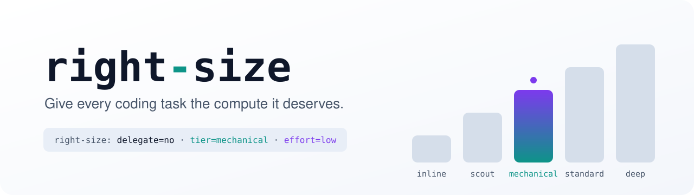
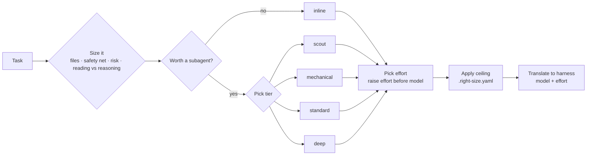
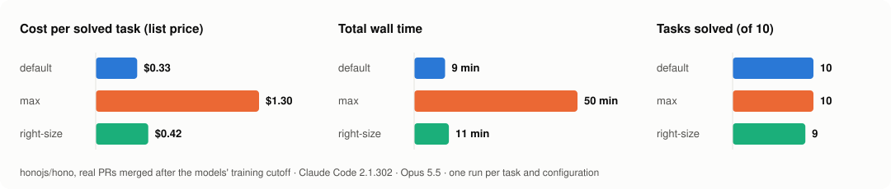

<div align="center">

<picture>
  <source media="(prefers-color-scheme: dark)" srcset="assets/banner-dark.svg">
  <source media="(prefers-color-scheme: light)" srcset="assets/banner-light.svg">
  
</picture>

<br/>

**An Agent Skill that decides whether a coding task deserves a subagent, which tier, and which reasoning effort — then applies it in your harness.**

[](LICENSE)
[](https://agentskills.io)
[](https://github.com/ciroperf/right-size/releases/latest)
[](#roadmap)
[](https://github.com/ciroperf/right-size/actions/workflows/tests.yml)
[](CONTRIBUTING.md)

[](#install)
[](#install)
[](#harness-support)
[](#harness-support)
[](#harness-support)

[Install](#install) · [Usage](#usage) · [How it works](#how-it-works) · [Tiers](#tiers) · [Harness support](#harness-support) · [Benchmark](#benchmark) · [FAQ](#faq)

</div>

---

## Why

Coding agents waste tokens in two predictable ways:

1. **Everything runs on the biggest model at the highest effort**, including renames and one-line fixes.
2. **Work gets delegated to subagents when doing it inline would be cheaper.** A subagent starts cold: its own system prompt, its own context, re-reading files the main agent already has.

`right-size` sizes the task first, then picks the smallest setup that still gets it done, and tells you when to step up.

```
right-size: delegate=no · tier=deep · effort=high
why: auth + users schema change (risk floor → deep), no tests, ~3 files
apply: inline; run the session on opus (/model opus) with /effort high (claude-code)
escalate if: deep attempt fails → fable/xhigh, only after you confirm
```

**What makes it different**

- 🧭 **It can say "don't delegate".** Inline is the default; a subagent has to earn its start-up cost.
- 🔌 **Multi-harness.** One decision, translated into each agent's native config: Claude Code, Codex, Antigravity, with more on the way.
- 🛡️ **Risk-aware, not keyword-based.** Auth, payments, migrations and public APIs start at the top tier, however small the diff. Read-only questions about them stay cheap.
- 📈 **Escalates on evidence.** Start low when tests exist; step up one tier on a verifiable failure, two on a reasoning failure.
- 📏 **Measured, not claimed.** A reproducible benchmark is part of the repo, including the cases where right-size makes things worse.

## Install

Install it for **every project** (global) or **just one project**. A project install lives in the repo, so you can try right-size on one codebase, or share it with your team, without touching anything else.

<details open>
<summary><strong>Claude Code</strong></summary>

Global, for all your projects:

```bash
claude plugin marketplace add ciroperf/right-size
claude plugin install right-size@ciroperf
```

Just this project, shared with the team through `.claude/settings.json` (teammates are offered the plugin when they open the repo):

```bash
claude plugin marketplace add ciroperf/right-size --scope project
claude plugin install right-size@ciroperf --scope project
```

Use `--scope local` instead for this project only, without committing anything.

</details>

<details>
<summary><strong>Codex</strong></summary>

Global, as a plugin that updates itself:

```bash
codex plugin marketplace add ciroperf/right-size
codex plugin add right-size@ciroperf
```

Just this project: Codex plugins are always user-wide, so copy the skills into the repo's `.agents/skills/` instead:

```bash
npx skills@latest add ciroperf/right-size -a codex
```

</details>

<details>
<summary><strong>Antigravity, Cursor, Copilot, Gemini CLI and others</strong> (manual updates)</summary>

Just this project (the default when run inside a repo):

```bash
npx skills@latest add ciroperf/right-size
```

Global: add `-g`. Pick agents with `-a`, e.g. `-a cursor`. Update later with `npx skills update`.

</details>

<details>
<summary><strong>Claude.ai or manual install</strong></summary>

Download from the [latest release](https://github.com/ciroperf/right-size/releases/latest):

- `right-size.skill`: upload it in Claude.ai under **Settings → Capabilities → Skills**.
- `right-size-vX.Y.Z.zip`: both skills. Copy the `skills/` folders into your agent's skills directory (for example `.claude/skills/` or `.agents/skills/`), keeping them side by side.

</details>

### Optional: generate the subagents

```text
> /right-size-setup
```

This writes one subagent per tier with model and effort preset: `.claude/agents/right-size-*.md` in Claude Code, `.codex/agents/right_size_*.toml` in Codex. It asks before overwriting anything. Without these agents right-size still works, but it can only pass a model per call, and effort then follows the session.

## Usage

It runs on its own when an agent is about to delegate, plan multi-step work, or pick a model. You can also ask for it directly:

```text
> right-size this before you start
> is this worth a subagent?
> size these four tickets
```

Each answer is a four-line block: the decision, the facts behind it, how to apply it in the harness you're in, and when to step up. At most three short notes follow, only for assumptions to confirm or things the subagent's brief must include.

<details>
<summary><strong>Example: a rename across a monorepo (Claude Code)</strong></summary>

```
right-size: delegate=yes · tier=mechanical · effort=low
why: 14 call sites in 9 unopened files, a one-sentence rename pattern, tsc --noEmit + vitest catch misses
apply: right-size-mechanical (haiku), or general-purpose with model=haiku if that agent doesn't exist (claude-code)
escalate if: tsc or vitest still red after a real attempt → standard (sonnet, medium)
```

</details>

<details>
<summary><strong>Example: a read-only question about payment code (Codex)</strong></summary>

```
right-size: delegate=no · tier=inline · effort=session
why: read-only (so payments doesn't push it to deep), likely 1-3 files once grep finds the entry point
apply: inline; keep session model and effort (codex)
escalate if: event handling fans out past ~10 files / ~2k lines → spawn right_size_scout (gpt-6-luna, effort low, read-only)
```

</details>

<details>
<summary><strong>Example: sizing a batch of tickets before fanning out</strong></summary>

```
1. right-size: delegate=no  · tier=inline   · effort=session   why: one line in list_display, field already exists
2. right-size: delegate=yes · tier=deep     · effort=high      why: float→Decimal data migration on a money column
3. right-size: delegate=yes · tier=standard · effort=medium    why: mechanical pattern, but scripts/ has no tests
4. right-size: delegate=yes · tier=standard · effort=medium    why: new view + button on an existing pattern
escalate if: tests red after a real attempt → one tier up; wrong approach → two tiers up
```

</details>

> The examples are real outputs from the skill's test suite (Claude Opus 5.5, October 2026), lightly trimmed.

### Router mode: size the whole session

Inside a session, right-size can only save by delegating: the main session keeps the model it started with. The router moves the decision in front of the session. One classifier call on the cheapest tier (about $0.002 in Claude Code) sizes the task with the same `tiers.yaml`, then the harness starts on that tier's model and effort.

```bash
python .claude/skills/right-size/scripts/route.py "fix the failing date parsing test"
```

```
right-size: route · tier=standard · model=sonnet · effort=medium
why: bug fix with a clear reproduction, tests present, not a risk area
escalate if: a real attempt fails → deep (opus, effort medium)
```

The script ships inside the skill folder and needs only Python 3.9+, no packages. Where it lives depends on how you installed right-size; inside a session, asking "give me the right-size router command" makes the skill print it with the full path.

| Install | Path to `route.py` |
|---|---|
| `npx skills add` (project) | `.claude/skills/right-size/scripts/route.py` (`.agents/skills/...` for Codex) |
| `npx skills add -g` | `~/.claude/skills/right-size/scripts/route.py` |
| Claude Code plugin | `~/.claude/plugins/cache/ciroperf/right-size/<version>/skills/right-size/scripts/route.py` |

A short alias helps:

```bash
alias rs='python .claude/skills/right-size/scripts/route.py'          # bash / zsh
```

```powershell
function rs { python .claude\skills\right-size\scripts\route.py @args }   # PowerShell
```

| Flag | What it does |
|---|---|
| `--print` | Run headless. If the session ends with `RIGHT-SIZE-ESCALATE: verifiable` or `reasoning`, the router resumes it one or two tiers up, within the ceiling, and prints the cost of each step |
| `--file <path>` | Read the task from a file, or from stdin with `-` |
| `--dry-run` | Show the decision and the command, don't run anything |
| `--tier <tier>` | Skip the classifier |
| `--split` | With `--print`: when the task is several independent requests, run each as its own session on its own tier. Measured so far: costs more than one session, see [`bench/`](bench/) |
| `--harness codex` | Launch Codex instead (`-m` plus `model_reasoning_effort`). Not yet tested end to end |
| `--json` | With `--print`: a JSON summary of the decision and every run |
| `-- <args>` | Pass the rest to the harness CLI, e.g. `-- --permission-mode acceptEdits` |

```
right-size: route · tier=mechanical · model=haiku · effort=low
right-size: escalate · mechanical → standard (sonnet, effort medium) · tests still red
right-size: done · mechanical (haiku) $0.01 → standard (sonnet) $0.07 · router $0.0002 · total $0.08
```

If the classifier can't run (CLI missing, not signed in, timeout), the router falls back to `standard` and says so. Interactive sessions get the same note, and the agent tells you which `/model` and `/effort` to switch to if it gets stuck. A switch resumes the same conversation, so nothing is lost, but the new model reads it once without cache. Whether routing beats the harness default on cost at equal results is what the [benchmark](#benchmark) is measuring next.

## How it works



The decision itself is kept cheap: it uses what's already in context plus at most a couple of quick lookups. Sizing a task should never cost more than the savings it's after.

## Tiers

Model names live only in the harness maps. The skill reasons in abstract tiers:

| Tier | For | Claude Code | Codex | Antigravity |
|---|---|---|---|---|
| `inline` | Small changes, files already in context | session model | session model | session model |
| `scout` | Read and search only | `haiku` · low | `gpt-6-luna` · low | Flash · Low |
| `mechanical` | Renames, boilerplate, import updates | `haiku` · low | `gpt-6-luna` · low | Flash · Low |
| `standard` | Ordinary features and fixes | `sonnet` · medium | `gpt-6.1-sol` · medium | Flash · High |
| `deep` | Auth, security, migrations, payments, concurrency | `opus` · medium | `gpt-6-astra` · high | Pro · High |

Advice-only maps, with no generated config yet:

| Tier | Cursor | Copilot |
|---|---|---|
| `scout`, `mechanical` | `composer-2.5` | Claude Haiku 5.5 |
| `standard` | `composer-2.5` | Claude Sonnet 5.5 |
| `deep` | `claude-opus-5[effort=high]` | Claude Opus 5.5 |

Mappings were verified against each vendor's docs (Cursor and Copilot on 2026-10-18, the others on 2026-10-17) and are not yet benchmarked. They live in [`skills/right-size/harnesses/`](skills/right-size/harnesses/), and keeping them current is most of this project's maintenance.

## Harness support

| Level | Harnesses | What you get |
|---|---|---|
| **Full** | Claude Code, Codex | Advice, native config, benchmark |
| **Advice + map** | Antigravity, Cursor, Copilot | Advice with native model names; generated config and a smoke test are planned |
| **Advice** | Any harness that loads Agent Skills | Advice in tier terms |

Gemini CLI was replaced by Antigravity CLI in June 2026, so it has no map of its own.

## Configuration

Cap the tier for a project by adding `.right-size.yaml` at the repo root:

```yaml
max_tier: standard   # anything above asks for confirmation first
```

## When not to use subagents

Delegation costs more than it saves when:

- the files are already in the main context;
- the change is a few lines;
- the brief would be about as long as the work;
- you are iterating on the change interactively;
- the "parallel" parts actually depend on each other.

## Benchmark

**v0, 2026-10-17:** 10 real [honojs/hono](https://github.com/honojs/hono) bug fixes merged after the models' training cutoff, scored by each PR's own tests. Claude Code 2.1.302 headless, Opus 5.5 main model, one run per task and configuration. Method, tasks and every run record are in [`bench/`](bench/).

<picture>
  <source media="(prefers-color-scheme: dark)" srcset="assets/bench-2026-10-17-v0-dark.svg">
  
</picture>

| Config | Solved | Total cost | Cost per solved task | Total tokens | Total time |
|---|---|---|---|---|---|
| `default` (Opus 5.5, default effort) | 10/10 | $3.31 | $0.33 | 4.40M | 9 min |
| `max` (Opus 5.5, effort `max`) | 10/10 | $13.01 | $1.30 | 15.80M | 50 min |
| `right-size` (skill + subagents) | 9/10 | $3.77 | $0.42 | 5.32M | 11 min |

What it shows, regressions included:

- **Maximum effort is the big waste.** `max` cost 3.9× as much and took 5.3× as long as the default, and solved nothing extra.
- **right-size did not beat the default.** It cost 14% more: reading the skill and sizing the task is overhead, and it never delegated, which was the right call. Every task was a fix inside one module, with the files already in context, so a cold-start subagent would have cost more.
- **One regression:** `trie-suffix-wildcard` failed under right-size, with 298 of 299 tests passing. It ran inline on the same model and effort as `default`, so this is most likely run-to-run variance. A single run per configuration can't prove it.
- **The lesson:** inside a session, advice alone can't save on small fixes, because the session keeps its model. That's why [router mode](#router-mode-size-the-whole-session) exists.

Next, benchmark v1: the `router` configuration, tasks where delegation can pay off (several independent tickets, large reading jobs), and three runs per configuration to measure variance.

One task prompt (`accepts-wildcard`) contradicted its PR's tests in the first pass and failed in all three configurations. It was corrected and all three reran; the note is in [`bench/tasks/hono.yaml`](bench/tasks/hono.yaml).

## FAQ

<details>
<summary><strong>Does it replace a model router or proxy?</strong></summary>

No. It works at the agent level, with the subagents and settings your harness already has. API-level routers such as claude-code-router or OpenRouter are complementary.

</details>

<details>
<summary><strong>How is this different from other routing skills?</strong></summary>

Some skills advise a tier and effort but leave the rest to you. Others hook every subagent spawn in a single harness. right-size also decides *whether* to delegate, maps the decision to native config in several harnesses, and backs it with a public benchmark.

</details>

<details>
<summary><strong>Will it go stale when new models ship?</strong></summary>

The skill reasons in tiers, so only the YAML maps need updating. Each map records the date it was verified.

</details>

## Roadmap

- [x] Advisor skill with tiers, risk floor and escalation
- [x] Harness maps for Claude Code, Codex and Antigravity
- [x] `right-size-setup`: generate native subagents (`scout`, `mechanical`, `standard`, `deep`) for Claude Code and Codex
- [x] Router mode: pick the session's model and effort before it starts (`scripts/route.py`)
- [x] Benchmark v0: one repo, one harness ([results](#benchmark))
- [x] Cursor and Copilot maps (advice only)
- [ ] Generated config and smoke tests for Antigravity, Cursor and Copilot
- [ ] Benchmark v1: Claude Code + Codex, published results

## Contributing

Model updates, new harness maps and benchmark tasks are all welcome. See [CONTRIBUTING.md](CONTRIBUTING.md).

## License

[MIT](LICENSE) © Ciro Perfetto
