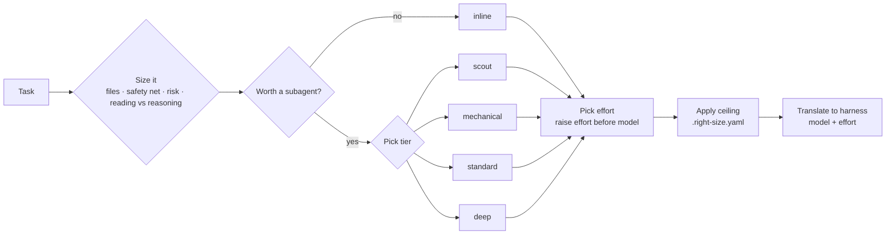

<div align="center">

<picture>
  <source media="(prefers-color-scheme: dark)" srcset="assets/banner-dark.svg">
  <source media="(prefers-color-scheme: light)" srcset="assets/banner-light.svg">
  
</picture>

<br/>

**Agent Skills and a small router that give every coding task the compute it deserves: the model and effort to start on, when to step up, and when a subagent is (rarely) worth it.**

[](LICENSE)
[](https://agentskills.io)
[](https://github.com/ciroperf/right-size/releases/latest)
[](#roadmap)
[](https://github.com/ciroperf/right-size/actions/workflows/tests.yml)
[](CONTRIBUTING.md)

[](#install)
[](#install)
[](#harness-support)
[](#harness-support)
[](#harness-support)

[Install](#install) · [Usage](#usage) · [How it works](#how-it-works) · [Tiers](#tiers) · [Harness support](#harness-support) · [Benchmark](#benchmark) · [FAQ](#faq)

</div>

---

## Why

Coding agents waste tokens in predictable ways:

1. **Everything runs on the biggest model at the highest effort**, including renames and one-line fixes.
2. **Work gets delegated to subagents when doing it inline would be cheaper.** A subagent starts cold: its own system prompt, its own context, re-reading files the main agent already has.

right-size sizes the work, starts on the smallest setup that still gets it done, and steps up only on evidence. What the [benchmark](#benchmark) has measured so far, on real bug fixes scored by their own tests:

| Finding | Measured |
|---|---|
| Maximum effort buys nothing on ordinary fixes | Opus at `max`: **3.9× the cost, 5.3× the time**, same 10/10 solved |
| A cheaper session model is where the saving is | Whole session on Sonnet: **60% cheaper, ~3× faster** than the Opus default, same 6/6 bugs solved |
| Subagents rarely pay off on small, related fixes | Forcing delegation: **about 2× the cost** of doing it inline |

<!-- TODO(0.4.0): add the v1 headline rows (ladder vs sonnet, hard tasks) once measured -->

These are single runs on one repo. See [Benchmark](#benchmark) for v1, with harder tasks.

**Four ways to use it**

- 📊 **`/right-size-audit`** reads the transcripts Claude Code already keeps and shows where your spend went: by model, by token kind, by subagent, and which change would cut it most. Local files only, no model calls.
- ⚙️ **`/right-size-defaults`** sets the model and effort your sessions start on, from the project's tests and risk profile. Most of the measured saving comes from here.
- 🧭 **Router mode** (`route.py`) starts a session on the cheapest tier that fits, checks every attempt (did anything change, do the tests pass, does a reviewer one tier up accept it) and steps up only when a check fails.
- 💬 **The `right-size` advisor** sizes work inside a session: inline or subagent, which tier, which effort, and when to step up.

```
right-size: delegate=no · tier=deep · effort=medium
why: auth + users schema change (risk floor → deep), no tests, ~3 files
apply: inline; run the session on opus (/model opus) at medium effort (claude-code)
escalate if: a verifiable failure → /effort high; past deep only after you confirm
```

**What makes it different**

- 🧭 **It can say "don't delegate".** Inline is the default; a subagent has to earn its start-up cost.
- 🔌 **Multi-harness.** One decision, translated into each agent's native config: Claude Code and Codex, with advice-only maps for Antigravity, Cursor and Copilot.
- 🛡️ **Risk-aware, not keyword-based.** Auth, payments, migrations and public APIs go to the top tier, however small the diff. Read-only questions about them stay cheap.
- 📈 **Escalates on evidence.** Start low when tests exist; step up one tier on a verifiable failure, two on a reasoning failure, and raise effort before going past the top tier.
- 📏 **Measured, not claimed.** The benchmark is in the repo, including every case where right-size made things worse.

## Install

Install it for **every project** (global) or **just one project**. A project install lives in the repo, so you can try right-size on one codebase, or share it with your team, without touching anything else.

<details open>
<summary><strong>Claude Code</strong></summary>

Global, for all your projects:

```bash
claude plugin marketplace add ciroperf/right-size
claude plugin install right-size@ciroperf
```

Just this project, shared with the team through `.claude/settings.json` (teammates are offered the plugin when they open the repo):

```bash
claude plugin marketplace add ciroperf/right-size --scope project
claude plugin install right-size@ciroperf --scope project
```

Use `--scope local` instead for this project only, without committing anything.

</details>

<details>
<summary><strong>Codex</strong></summary>

Global, as a plugin that updates itself:

```bash
codex plugin marketplace add ciroperf/right-size
codex plugin add right-size@ciroperf
```

Just this project: Codex plugins are always user-wide, so copy the skills into the repo's `.agents/skills/` instead:

```bash
npx skills@latest add ciroperf/right-size -a codex
```

</details>

<details>
<summary><strong>Antigravity, Cursor, Copilot and others</strong> (manual updates)</summary>

Just this project (the default when run inside a repo):

```bash
npx skills@latest add ciroperf/right-size
```

Global: add `-g`. Pick agents with `-a`, e.g. `-a cursor`. Update later with `npx skills update`.

</details>

<details>
<summary><strong>Claude.ai or manual install</strong></summary>

Download from the [latest release](https://github.com/ciroperf/right-size/releases/latest):

- `right-size.skill`: upload it in Claude.ai under **Settings → Capabilities → Skills**.
- `right-size-vX.Y.Z.zip`: all four skills. Copy the `skills/` folders into your agent's skills directory (for example `.claude/skills/` or `.agents/skills/`), keeping them side by side.

</details>

### Recommended: set the project's default model and effort

```text
> /right-size-defaults
```

It checks the project's safety net and risk profile, recommends the model and effort new sessions should start on, and writes them on your confirmation (`model` and `effortLevel` in `.claude/settings.local.json` or `.claude/settings.json`; `model` and `model_reasoning_effort` in `.codex/config.toml`). It never picks `high` or above as a default: those are escalation steps. This is where most of the measured saving comes from (see [Benchmark](#benchmark)).

### Optional: generate the subagents

```text
> /right-size-setup
```

This writes one subagent per tier with model and effort preset: `.claude/agents/right-size-*.md` in Claude Code, `.codex/agents/right_size_*.toml` in Codex. It asks before overwriting anything. Without these agents right-size still works, but it can only pass a model per call, and effort then follows the session.

### Optional: see where your spend goes

```text
> /right-size-audit
```

It prices the session transcripts in `~/.claude/projects/` at list price (last 30 days of the current project by default) and reports the split by model, by token kind (input, output, cache read, cache write) and by subagent, plus the patterns that cost the most: model switches inside a conversation, top-tier sessions that barely edited anything, subagents on the top model doing reading. It then recommends at most two changes. Also runs from a terminal:

```bash
python .claude/skills/right-size-audit/scripts/audit.py --days 7      # --all for every project, --json for the numbers
```

It is a good first step before any cost-saving tool, this one included: tools that shorten replies only touch the output share, which is often under a fifth of the bill.

## Usage

It runs on its own when an agent is about to delegate, plan multi-step work, or pick a model. You can also ask for it directly:

```text
> right-size this before you start
> is this worth a subagent?
> size these four tickets
```

Each answer is a four-line block: the decision, the facts behind it, how to apply it in the harness you're in, and when to step up. At most three short notes follow, only for assumptions to confirm or things the subagent's brief must include.

<details>
<summary><strong>Example: a rename across a monorepo (Claude Code)</strong></summary>

```
right-size: delegate=yes · tier=mechanical · effort=low
why: 14 call sites in 9 unopened files, a one-sentence rename pattern, tsc --noEmit + vitest catch misses
apply: right-size-mechanical (haiku), or general-purpose with model=haiku if that agent doesn't exist (claude-code)
escalate if: tsc or vitest still red after a real attempt → standard (sonnet, medium)
```

</details>

<details>
<summary><strong>Example: a read-only question about payment code (Codex)</strong></summary>

```
right-size: delegate=no · tier=inline · effort=session
why: read-only (so payments doesn't push it to deep), likely 1-3 files once grep finds the entry point
apply: inline; keep session model and effort (codex)
escalate if: event handling fans out past ~10 files / ~2k lines → spawn right_size_scout (gpt-6-luna, effort low, read-only)
```

</details>

<details>
<summary><strong>Example: sizing a batch of tickets before fanning out</strong></summary>

```
1. right-size: delegate=no  · tier=inline   · effort=session   why: one line in list_display, field already exists
2. right-size: delegate=yes · tier=deep     · effort=high      why: float→Decimal data migration on a money column
3. right-size: delegate=yes · tier=standard · effort=medium    why: mechanical pattern, but scripts/ has no tests
4. right-size: delegate=yes · tier=standard · effort=medium    why: new view + button on an existing pattern
escalate if: tests red after a real attempt → one tier up; wrong approach → two tiers up
```

</details>

> The examples are real outputs from the skill's test suite (Claude Opus 5.5, October 2026), lightly trimmed.

### Router mode: size the whole session

Inside a session, right-size can only save by delegating: the main session keeps the model it started with. The router moves the decision in front of the session.

In headless mode (`--print`) it climbs a ladder. It starts on the `mechanical` tier when it can run the project's tests, and after each attempt it runs three checks:

1. **Did anything change?** An empty diff fails.
2. **Do the tests pass?** Your `--verify-cmd`, or the test command it finds in `package.json`, `Cargo.toml`, `go.mod`, a pytest config or a `Makefile` (it prints which). Without one it starts on `standard`, since a review alone can miss what a test catches. For speed, point it at the tests related to the change (e.g. `npx vitest --run --changed`); that won't catch a regression in an unrelated module.
3. **Does a reviewer one tier up accept the diff?** Work on the cheapest tier is always reviewed, so is every attempt after a failed check, and so is every change in a risk area (auth, security, payments, migrations, breaking public APIs), on the `deep` tier. The reviewer may write a throwaway test and run it with the project's test runner (the only command it is allowed); the working tree is restored afterwards. A first attempt on `standard` or above, outside risk areas, has only the tests as its check.

A failed check moves the task one tier up. A model change starts a fresh session with a brief (the task, the current diff, why it failed), because resuming would make the bigger model re-read the whole conversation without cache; an effort-only change resumes the same session. At most three steps by default.

```bash
python .claude/skills/right-size/scripts/route.py --print --verify-cmd "npm test" "fix the failing date parsing test"
```

```
right-size: route · tier=mechanical · model=haiku · effort=low
why: ladder: start on the cheapest writing tier, checks escalate on failure
escalate if: a real attempt fails → standard (sonnet, effort medium)
```

<!-- TODO(0.4.0): replace with a real escalate/done pair from a bench run -->

With `--classify`, one call on the cheapest tier (about $0.002) sizes the task with the same `tiers.yaml` and picks the starting tier instead. In the benchmark so far that solved the same tasks as the ladder at about three times the cost, so it is opt-in. Without `--print` nothing checks the work automatically, so the router opens the interactive session on `standard` (or on the classifier's tier with `--classify`).

The script ships inside the skill folder and needs only Python 3.9+, no packages. Where it lives depends on how you installed right-size; inside a session, asking "give me the right-size router command" makes the skill print it with the full path.

| Install | Path to `route.py` |
|---|---|
| `npx skills add` (project) | `.claude/skills/right-size/scripts/route.py` (`.agents/skills/...` for Codex) |
| `npx skills add -g` | `~/.claude/skills/right-size/scripts/route.py` |
| Claude Code plugin | `~/.claude/plugins/cache/ciroperf/right-size/<version>/skills/right-size/scripts/route.py` |

A short alias helps:

```bash
alias rs='python .claude/skills/right-size/scripts/route.py'          # bash / zsh
```

```powershell
function rs { python .claude\skills\right-size\scripts\route.py @args }   # PowerShell
```

| Flag | What it does |
|---|---|
| `--print` | Run headless with checks and escalation, and print the cost of each step |
| `--verify-cmd <cmd>` | With `--print`: the command that must pass after each attempt, e.g. `"npm test"`. Detected when omitted; `""` turns it off |
| `--review auto\|always\|never` | With `--print`: when to run the review one tier up (`auto` by default) |
| `--no-checks` | With `--print`: escalate only when the session asks for it (`RIGHT-SIZE-ESCALATE:`), the 0.3.0 behavior |
| `--max-escalations <n>` | Steps up allowed after the first attempt (default 3) |
| `--classify` | Size the task with a classifier call instead of starting on the ladder |
| `--tier <tier>` | Start on this tier |
| `--file <path>` | Read the task from a file, or from stdin with `-` |
| `--dry-run` | Show the decision and the command, don't run anything |
| `--split` | With `--print`: when the task is several independent requests, run each as its own session on its own tier (implies `--classify`). Measured so far: costs more than one session, see [`bench/`](bench/) |
| `--log <dir>` | With `--print`: save each attempt's stream-json transcript in this folder |
| `--harness codex` | Launch Codex instead (`-m` plus `model_reasoning_effort`). Not yet tested end to end |
| `--json` | With `--print`: a JSON summary of the decision and every run |
| `-- <args>` | Pass the rest to the harness CLI, e.g. `-- --permission-mode acceptEdits` |

If the classifier can't run (CLI missing, not signed in, timeout), the router falls back to `standard` and says so. Interactive sessions get a note telling the agent which `/model` and `/effort` to suggest if it gets stuck.

## How it works



The decision itself is kept cheap: it uses what's already in context plus at most a couple of quick lookups. Sizing a task should never cost more than the savings it's after.

## Tiers

Model names live only in the harness maps. The skill reasons in abstract tiers:

| Tier | For | Claude Code | Codex | Antigravity |
|---|---|---|---|---|
| `inline` | Small changes, files already in context | session model | session model | session model |
| `scout` | Read and search only | `haiku` · low | `gpt-6-luna` · low | Flash · Low |
| `mechanical` | Renames, boilerplate, import updates | `haiku` · low | `gpt-6-luna` · low | Flash · Low |
| `standard` | Ordinary features and fixes | `sonnet` · medium | `gpt-6.1-sol` · medium | Flash · High |
| `deep` | Auth, security, migrations, payments, concurrency | `opus` · medium | `gpt-6-astra` · high | Pro · High |

Advice-only maps, with no generated config yet:

| Tier | Cursor | Copilot |
|---|---|---|
| `scout`, `mechanical` | `composer-2.5` | Claude Haiku 5.5 |
| `standard` | `composer-2.5` | Claude Sonnet 5.5 |
| `deep` | `claude-opus-5[effort=high]` | Claude Opus 5.5 |

Mappings were verified against each vendor's docs (Cursor and Copilot on 2026-10-18, the others on 2026-10-17) and are not yet benchmarked. They live in [`skills/right-size/harnesses/`](skills/right-size/harnesses/), and keeping them current is most of this project's maintenance.

## Harness support

| Level | Harnesses | What you get |
|---|---|---|
| **Full** | Claude Code, Codex | Advice, native config, benchmark |
| **Advice + map** | Antigravity, Cursor, Copilot | Advice with native model names; generated config and a smoke test are planned |
| **Advice** | Any harness that loads Agent Skills | Advice in tier terms |

Gemini CLI was replaced by Antigravity CLI in June 2026, so it has no map of its own.

## Configuration

Cap the tier for a project by adding `.right-size.yaml` at the repo root:

```yaml
max_tier: standard   # anything above asks for confirmation first
```

## When not to use subagents

Delegation costs more than it saves when:

- the files are already in the main context;
- the change is a few lines;
- the brief would be about as long as the work;
- you are iterating on the change interactively;
- the "parallel" parts actually depend on each other.

## Benchmark

**v0, 2026-10-17:** 10 real [honojs/hono](https://github.com/honojs/hono) bug fixes merged after the models' training cutoff, scored by each PR's own tests. Claude Code 2.1.302 headless, Opus 5.5 main model, one run per task and configuration. Method, tasks and every run record are in [`bench/`](bench/).

<picture>
  <source media="(prefers-color-scheme: dark)" srcset="assets/bench-2026-10-17-v0-dark.svg">
  
</picture>

| Config | Solved | Total cost | Cost per solved task | Total tokens | Total time |
|---|---|---|---|---|---|
| `default` (Opus 5.5, default effort) | 10/10 | $3.31 | $0.33 | 4.40M | 9 min |
| `max` (Opus 5.5, effort `max`) | 10/10 | $13.01 | $1.30 | 15.80M | 50 min |
| `right-size` (skill + subagents) | 9/10 | $3.77 | $0.42 | 5.32M | 11 min |

What it shows, regressions included:

- **Maximum effort is the big waste.** `max` cost 3.9× as much and took 5.3× as long as the default, and solved nothing extra.
- **right-size did not beat the default.** It cost 14% more: reading the skill and sizing the task is overhead, and it never delegated, which was the right call. Every task was a fix inside one module, with the files already in context, so a cold-start subagent would have cost more.
- **One regression:** `trie-suffix-wildcard` failed under right-size, with 298 of 299 tests passing. It ran inline on the same model and effort as `default`, so this is most likely run-to-run variance. A single run per configuration can't prove it.
- **The lesson:** inside a session, advice alone can't save on small fixes, because the session keeps its model. That's why [router mode](#router-mode-size-the-whole-session) exists.

**Batches, 2026-10-18:** two prompts with three independent Hono bugs each, every bug scored by its own PR's tests. One run per configuration. Records in [`bench/results/2026-10-18-batch/`](bench/results/2026-10-18-batch/).

| Config | Bugs solved | Total cost | Total time |
|---|---|---|---|
| `router-standard` (whole session on Sonnet, medium) | 6/6 | **$0.41** | 1 min |
| `default` (Opus 5.5, medium) | 6/6 | $1.03 | 3 min |
| `router-split` (one session per bug, each on its own tier) | 6/6 | $1.29 | 4 min |
| `right-size` (advisor; chose inline) | 6/6 | $1.32 | 3 min |
| `router` (risk floor sent both batches to Opus at high effort) | 6/6 | $1.48 | 4 min |
| `delegate` (experiment: every bug forced onto a subagent) | 6/6 | $2.09 | 4 min |

- **The saving is the session model.** Sonnet solved all six, including the two security fixes, for 60% less than the default.
- **Subagents didn't pay.** The Haiku and Sonnet subagents were cheap, but the Opus session's briefing and review, plus security parts sent to a cold Opus subagent, doubled the cost. The advisor's choice to stay inline was right.
- **What changed because of it:** the `deep` tier now starts at medium effort, with high as its first escalation step, and `/right-size-defaults` exists.

**v1, 2026-10-21 → <!-- TODO(0.4.0) date -->:** does a router with checks beat simply running everything on Sonnet? 11 tasks (v0 fixes, two batches, four harder tasks) plus <!-- TODO(0.4.0): N --> hard multi-module tasks that Haiku fails, scored by each PR's own tests. Records in [`bench/results/`](bench/results/).

<!-- TODO(0.4.0): table from bench/results/2026-10-21-v1-checks + the rerun + v2-hard. Columns: config, solved, total cost, cost per solved task. Rows: sonnet, ladder, router (--classify), opus-high reference. -->

| Config | v1 solved | v1 cost | hard solved | hard cost |
|---|---|---|---|---|
| `sonnet` (whole session on Sonnet, medium) | TBD | TBD | TBD | TBD |
| `ladder` (`route.py --print`, checks) | TBD | TBD | TBD | TBD |
| `router` (`route.py --print --classify`) | TBD | TBD | TBD | TBD |
| `opus-high` (reference) | — | — | TBD | TBD |

What changed because of v1, measured on its first pass:

- **Sessions never asked to escalate.** In the pilot, every failed session stopped with a wrong answer at every tier. The router now checks each attempt itself; with checks, escalation fired where it should.
- **Resuming on a bigger model was the expensive part of an escalation**: most of one ladder run's cost was Opus re-reading the earlier conversation uncached. A model change now starts a fresh session with a brief.
- **Tests and a read-only review both missed a defect** that a cheap model introduced. The reviewer may now write a throwaway test and run it. (In the first runs with this change every probe was denied, because headless sessions block shell commands that aren't explicitly allowed; the reviewer now gets the project's test runner. <!-- TODO(0.4.0): measured effect -->)
- **The classifier did not pay for itself**: same solved count as the ladder at about three times the cost. It is now opt-in (`--classify`).

One task prompt (`accepts-wildcard`) contradicted its PR's tests in the first pass and failed in all three configurations. It was corrected and all three reran; the note is in [`bench/tasks/hono.yaml`](bench/tasks/hono.yaml).

## FAQ

<details>
<summary><strong>Does it replace a model router or proxy?</strong></summary>

No. Router mode only picks the model and effort a harness session starts with, using the harness's own CLI flags; it never sits between the agent and the API. API-level routers such as claude-code-router or OpenRouter are complementary.

</details>

<details>
<summary><strong>How is this different from other routing skills?</strong></summary>

Some skills advise a tier and effort but leave the rest to you. Others hook every subagent spawn in a single harness. right-size also decides *whether* to delegate, maps the decision to native config in several harnesses, and backs it with a public benchmark.

</details>

<details>
<summary><strong>Can the advisor change the model of the session I'm in?</strong></summary>

No. Inside a running session nothing can switch the main model or effort for you: right-size can only tell you which `/model` or `/effort` to run. That's why the measured savings come from `/right-size-defaults` and router mode, which act before the session starts.

</details>

<details>
<summary><strong>Will it go stale when new models ship?</strong></summary>

The skill reasons in tiers, so only the YAML maps need updating. Each map records the date it was verified.

</details>

## Roadmap

- [x] Advisor skill with tiers, risk floor and escalation
- [x] Harness maps for Claude Code, Codex and Antigravity
- [x] `right-size-setup`: generate native subagents (`scout`, `mechanical`, `standard`, `deep`) for Claude Code and Codex
- [x] `right-size-defaults`: recommend and set the project's default model and effort
- [x] Router mode: pick the session's model and effort before it starts (`scripts/route.py`)
- [x] Benchmark v0: one repo, one harness ([results](#benchmark))
- [x] Batch experiments: delegation, split and pinned-tier routing ([results](#benchmark))
- [x] Cursor and Copilot maps (advice only)
- [ ] Generated config and smoke tests for Antigravity, Cursor and Copilot
- [x] Router with checks: empty-diff, test command and probing review one tier up; fresh-brief escalation
- [x] `right-size-audit`: where a project's Claude Code spend went, from local transcripts
- [x] Benchmark v1: router vs always-Sonnet, harder tasks ([results](#benchmark))
- [ ] Benchmark v1 with three runs per configuration
- [ ] Codex end-to-end runs of the router and benchmark

## Contributing

Model updates, new harness maps and benchmark tasks are all welcome. See [CONTRIBUTING.md](CONTRIBUTING.md).

## License

[MIT](LICENSE) © Ciro Perfetto
